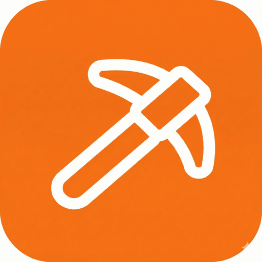

<div align="center">

🌐 [English](./README.md) · **中文**



# drillr · DeepSeek Harness 插件

给 DeepSeek Harness 智能体的金融数据与研究工具：公司公告与财报、财务报表、公司发现、财务表只读 SQL、新闻与研究信号，覆盖美股、日股和 A 股，每个数字都能追溯到出处文件。

</div>

本插件通过 **DSH 官方 MCP 客户端**，把 DeepSeek Harness（dsh）连到 drillr 托管的 MCP 服务（`https://gateway.drillr.ai/mcp/data`）。插件会在 **设置 → drillr** 加一个页面，用来保存 drillr API key；key 存在本机 DSH 的凭据库里，不写进配置文件，也不经过对话。

## 安装

**DSH 桌面版：** 打开 **插件 → 添加插件**，填入 `https://github.com/Little-Grebe-Inc/dsh-drillr`，点 **安装**。装了社区插件市场的话，也可以在市场里搜索 `drillr`。

**命令行**（`dsh web` 或自定义 profile）：

```sh
dsh plugin --profile web add github:Little-Grebe-Inc/dsh-drillr
```

插件是纯 JavaScript、没有构建步骤，从 GitHub 安装不需要授权构建脚本。每个 [Release](https://github.com/Little-Grebe-Inc/dsh-drillr/releases) 也附带预打包的 tarball：

```sh
dsh plugin --profile web add https://github.com/Little-Grebe-Inc/dsh-drillr/releases/latest/download/dsh-drillr.tgz
```

## 设置 key

1. 在 [drillr.ai/account/api-keys](https://drillr.ai/account/api-keys) 创建 API key。
2. 在 DSH 打开 **设置 → drillr**，粘贴 key，点 **保存 key**。
3. 页面显示 **Key：已保存**，几秒后显示 **工具：已连接**。

然后直接问智能体，例如：

```text
用 drillr 查一下苹果公司的股票代码
```

智能体调用 `mcp__drillr__ticker_lookup` 并回答 Apple Inc. / AAPL，即连接成功。

## 工具

插件把 drillr 的 10 个 MCP 工具注册为 `mcp__drillr__<工具名>`：

| 分组 | 工具 | 作用 |
|---|---|---|
| 公司 | `ticker_lookup` | 把公司名或部分代码解析成上市代码 |
| 公司 | `company_search` | 用一段自然语言描述找公司 |
| 公告 | `filing_list` | 列出一家公司已收录的公告 |
| 公告 | `filing_search` | 检索一家公司的公告：as-reported 原值和匹配的原文段落 |
| 数据集 | `list_tables` | 浏览另类数据表目录 |
| 数据集 | `get_table_schema` | 单张表的字段与覆盖范围说明 |
| 数据集 | `run_sql` | 对财务表和另类数据表执行只读 SQL |
| 信号 | `news_search` | 公司、主题或市场的新闻报道、事件和有出处的表态 |
| 信号 | `industry_inflections` | 对美股上市公司业绩电话会做结构化研究得出的行业拐点 |
| 信号 | `ai_adoption` | 美股公司业绩电话会披露的具体企业 AI 应用 |

每个工具的说明见 [drillr.ai/docs/mcp](https://drillr.ai/docs/mcp)。

**覆盖范围。** 核心股票覆盖美股、日股（`7203.T`）和 A 股（`600519.SH` / `000001.SZ`）。部分数据集范围更窄（例如电话会只有美股和日股，分析师与持股数据只有美股）；每张表的覆盖范围以 `get_table_schema` 的说明为准。

## 工作方式

插件包往 profile 里加两行：

| 行 | 包 | 作用 |
|---|---|---|
| `drillr-settings` | `dsh-drillr` | **设置 → drillr** 页面，以及保存、查看、删除 `DRILLR_API_KEY` 凭据的本机接口 |
| `drillr-mcp` | `@deepseek-ai/dsh-mcp-client` | 官方 MCP 客户端：Streamable HTTP 连 `https://gateway.drillr.ai/mcp/data`，请求头 `Authorization: Bearer ${credential:DRILLR_API_KEY}` |

key 保存之前，MCP 这一行会等待凭据，不会报错。保存、替换或删除 key 都无需重启。也可以把 key 写成 `$DSH_HOME/.env` 里的 `DRILLR_API_KEY`，或放在启动 dsh 的环境变量里。

drillr 对支持 OAuth 的 MCP 客户端提供浏览器登录。DSH 官方 MCP 客户端发布 OAuth 后，本插件会改成浏览器登录。

已在 DeepSeek Harness 桌面版 0.2.2-rc.2（macOS）上测试。

## 隐私

key 只保存在本机 DSH 凭据库（默认 `$DSH_HOME/.credentials.yaml`，只有你的系统用户可读）。插件只把它作为 MCP 请求的 Bearer token 发给 `gateway.drillr.ai`。drillr 隐私政策：[drillr.ai/privacy](https://drillr.ai/privacy)。

## 链接

- drillr MCP 服务与其他客户端：[Little-Grebe-Inc/drillr-mcp-server](https://github.com/Little-Grebe-Inc/drillr-mcp-server)
- 研究流程智能体技能：[Little-Grebe-Inc/drillr-skill](https://github.com/Little-Grebe-Inc/drillr-skill)
- 反馈：[github.com/Little-Grebe-Inc/dsh-drillr/issues](https://github.com/Little-Grebe-Inc/dsh-drillr/issues)

MIT © Little Grebe Inc.
